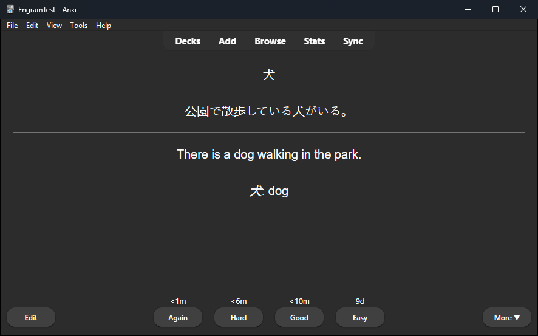
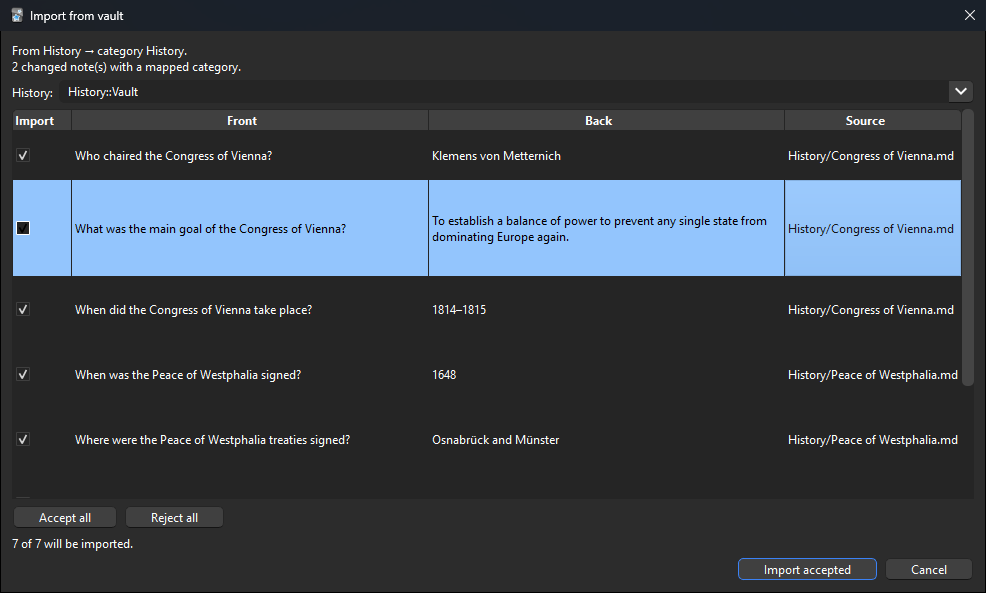

# Engram for Anki

Engram watches the decks you already study. When a card graduates into review,
it adds a new AI-written practice card to a separate deck: a new example
sentence for a word, or the same fact asked a different way. Your original
cards are never changed.

It runs on a free AI model on your own computer (Ollama), so your cards don't
leave your machine.



---

## Quickstart (about 10 minutes)

You need **Anki 23.10 or newer** and a computer with about **8 GB of RAM**.

1. **Install Ollama.** Download it from <https://ollama.com> and start it. It
   runs in the background (on Windows and macOS you'll see its icon in the
   system tray / menu bar).

2. **Download the AI model.** Open a terminal (Windows: *PowerShell*; macOS:
   *Terminal*) and run:

   ```bash
   ollama pull qwen2.5:7b
   ```

   It's about 4.7 GB. One model covers every subject and language.

3. **Install Engram.** In Anki: **Tools → Add-ons → Get Add-ons…**, paste
   Engram's code from its [AnkiWeb page](https://ankiweb.net/shared/addons),
   and restart Anki.
   (Or download `ai_srs-1.0.0.ankiaddon` from the
   [Releases page](https://github.com/PBT-Builds/Engram/releases) and use
   **Tools → Add-ons → Install from file…**.)

4. **Tell Engram which decks to use.** **Tools → Engram → Setup categories…**
   - **Real deck:** pick one of your existing decks from the list (a parent
     deck covers everything under it).
   - **Category:** what the deck is about. Pick one from the list or type your
     own, e.g. `Japanese` or `History`.
   - **Model:** leave it at `qwen2.5:7b`.
   - **Card type:** `language` for vocabulary, `knowledge` for facts.

   Click **OK**. Repeat for other decks if you like.

   

5. **Study as usual.** When a card in that deck graduates from *learning* to
   *review*, Engram writes one new practice card into the deck
   `<Category>::Learning` (for example `Japanese::Learning`). If your deck has
   the same name as the category, that deck appears inside it: click the **+**
   next to your deck to see it. Study it like any other deck.

   The very first AI card can take up to a minute while Ollama loads the model;
   after that, cards take a few seconds. To try it right away, study a new
   card in that deck and answer **Easy**: it graduates at once.

To check everything is ready: **Tools → Engram → Test connection**. It should
say *reachable ✓* for `local` and list `qwen2.5:7b`. It also lists `claude` as
*not configured (optional)*. That's fine: Claude is only used for the optional
vault import below.


---

## What the AI cards look like

- **Language** (`language`): the word, a short example sentence that uses it,
  and on the back an English translation and the word's meaning. Engram checks
  that the sentence really contains the word.
- **Knowledge** (`knowledge`): your card's fact, asked from another angle or the
  other way round. A small local model can't verify facts, so treat these as
  practice, not as a source.

If the AI fails (Ollama not running, model not downloaded, unusable answer),
Engram uses a copy of your original card instead. A review is never blocked and
you never get an error dialog.

### Where the cards go

Each generated card moves through three decks next to your own:

| Deck | What happens |
|---|---|
| `<Category>::Learning` | New AI card. Get it right and it moves on. |
| `<Category>::Recycled` | Practised again with freshly written content each time. Three good rounds and it graduates. Three misses in a row send it back to Learning. |
| `<Category>::Legacy` | A copy of your **original** card, filed as done. |

Engram only adds cards to these decks. It never edits, moves, reschedules or
deletes the cards in your own decks.

---

## Troubleshooting

**Start with Tools → Engram → Test connection.** It checks every AI provider
Engram is set up to use and tells you what's wrong.

| What you see | What to do |
|---|---|
| `local` — *NOT reachable* | Ollama isn't running. Start the Ollama app (or run `ollama serve`) and try again. |
| *Model 'X' is configured … but not installed. Run: ollama pull X* | Run that exact command in a terminal, then try again. |
| The first AI card of the day takes a while, and Anki shows "Warming up model…" | Normal. Ollama loads the model into memory on first use, which can take up to a minute on a slow computer. Later cards take a few seconds. Engram waits up to 3 minutes for that first card. |
| AI cards are just copies of my original cards | The AI failed and Engram used your card instead. Run Test connection. Often the model isn't downloaded. |
| `claude` — *not configured (optional)* | Only needed for **Import from vault** (below). Ignore it otherwise. |

**Tools → Engram → Getting started…** shows the same checks in one place.

Still stuck? The log is at
`<Anki add-ons folder>/<Engram folder>/user_files/ai_srs.log`. Every line has a
timestamp and your profile name. Please attach it to a
[GitHub issue](https://github.com/PBT-Builds/Engram/issues).

---

## Import from an Obsidian vault (optional)

Engram can also suggest flashcards from your [Obsidian](https://obsidian.md)
notes (any folder of `.md` files works).

1. **Tools → Engram → Import from vault…** The first time, choose your vault
   folder. Change it later with **Choose vault folder…**.
2. Tick the folders or notes to import and type a category and a deck.
3. Engram tells you how many notes it will send to the AI and asks before
   sending anything. A note that hasn't changed since last time is never sent
   again.
4. Review the suggested cards: untick to reject, click a cell to edit. Only
   **Import accepted** adds anything to your collection, as ordinary Basic
   notes in one undo step (Ctrl+Z undoes the whole import).



By default, extraction uses **Claude** (Anthropic's API), which needs your own
API key in the `ANTHROPIC_API_KEY` environment variable and costs a few cents
per note. To keep everything local instead, set `"extraction_provider": "local"`
in **Tools → Add-ons → Engram → Config**. Engram then uses your Ollama model.

---

## Privacy

- Your cards and notes are sent **only to the AI you choose**. By default
  that's Ollama on your own computer, so nothing leaves your machine.
- Vault import with Claude sends the text of the notes you pick to Anthropic,
  and only after you confirm.
- **Nothing is ever sent to me (the author).** Engram has no telemetry, no
  analytics, no account and no server of its own.

---

## Settings

Most people only need the dialogs above. Everything else is in
**Tools → Add-ons → Engram → Config** and is documented in
[`config.md`](src/ai_srs/config.md), including:

- other AI servers (LM Studio, llama.cpp, Jan, or any OpenAI-compatible API;
  set `providers.local.api_base`),
- a bigger model for knowledge subjects (`phi4`, needs ~16 GB RAM; choose it
  per category in Setup categories),
- thresholds such as how many good rounds graduate a card.

Each Anki profile keeps its own deck assignments, vault folder and Engram data,
so two people sharing a computer don't mix their cards.

---

## For developers

- Build the add-on file: `bash scripts/build_ankiaddon.sh` →
  `dist/ai_srs-<version>.ankiaddon`. It never includes your data (`user_files/`,
  `meta.json`, logs).
- Run from source: link `src/ai_srs` into Anki's `addons21` folder as `ai_srs`
  (`scripts/install_symlink.sh` on macOS/Linux). Restart Anki after changes.
- Tests are plain-Python and need no Anki running:
  `for f in tests/test_*.py; do python "$f"; done`.
- How Engram is tested in Anki: [`TESTING.md`](TESTING.md).

Built by **[pbt-builds](https://github.com/PBT-Builds)**, with
[Claude Code](https://claude.com/claude-code) as a pair-programming partner.
Every change was reviewed and tested by a person before shipping.

Issues and contributions: <https://github.com/PBT-Builds/Engram>.

## License

Copyright (C) 2026 pbt-builds

AGPL-3.0-or-later. See [`LICENSE`](LICENSE). This matches Anki's own license.
